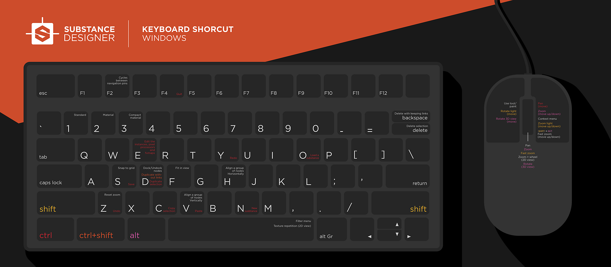
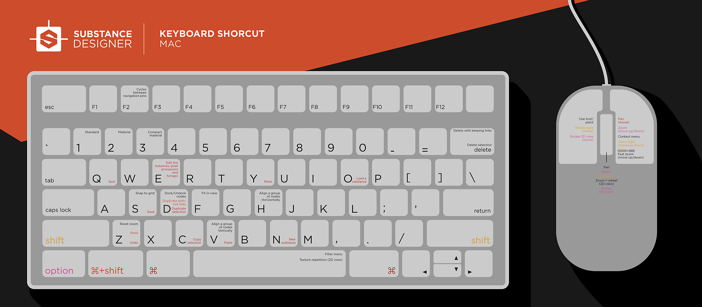

# Shortcuts

On this page you can find an overview of all shortcuts for Substance 3D Designer.

## Keymaps

**Windows**

{zoomable="yes"}

**macOS**

{zoomable="yes"}

## Shortcuts lists

### Global

| Action                  | Windows      | macOS        |
|:------------------------|:-------------|:-------------|
| New Substance graph     | Ctrl + N     | ⌘ + N        |
| Load package            | Ctrl + O     | ⌘ + O        |
| Save package            | Ctrl + S     | ⌘ + S        |
| Save all packages       | Ctrl + ⇧ + S | ⌘ + ⇧ + S    |
| Undo                    | Ctrl + Z     | ⌘ + Z        |
| Redo                    | Ctrl + Y     | ⌘ + Y        |
| Contextual menu         | RMB          | RMB          |
| Maximize dock           | ⇧ + Spacebar | ⇧ + Spacebar |
| Switch engines          | F9           | F9           |
| Suspend engine          | ⇧ + Escape   | ⇧ + Escape   |

{style="table-layout:fixed"}

### Graph View

**Viewport**

| Action                | Windows                                | macOS                                |
|:----------------------|:---------------------------------------|:-------------------------------------|
| Zoom                  | MouseWheel Alt + RMB + Drag         | MouseWheel ⌥ + RMB + Drag         |
| Fast zoom             | ⇧ + MouseWheel ⇧ + Alt + RMB + Drag | ⇧ + MouseWheel ⇧ + ⌥ + RMB + Drag |
| Pan                   | MMB + Drag Ctrl + RMB + Drag        | MMB + Drag ⌘ + RMB + Drag         |
| Reset zoom            | Z                                      | Z                                    |
| Fit in view           | F                                      | F                                    |
| Copy                  | Ctrl + C                               | ⌘ + C                                |
| Paste                 | Ctrl + V                               | ⌘ + V                                |
| Search                | Ctrl + F                               | ⌘ + F                                |
| Node menu             | Spacebar                               | Spacebar                             |
| Cycle navigation pins | F2                                     | F2                                   |

{style="table-layout:fixed"}

**Making selections**

| Action                    | Windows            | macOS          |
|:--------------------------|:-------------------|:---------------|
| Select add                | Ctrl + A           | ⌘ + A          |
| Toggle selected           | Ctrl + LMB         | ⌘ + LMB        |
| Marquee select (Add)      | Ctrl + LMB + Drag  | ⌘ + LMB + Drag |
| Marquee select (Subtract) | Shift + LMB + Drag | ⇧ + LMB + Drag |

{style="table-layout:fixed"}

**On selected items**

| Action                              | Windows      | macOS     |
|:------------------------------------|:-------------|:----------|
| Copy selection                      | Ctrl + C     | ⌘ + C     |
| Duplicate selection                 | Ctrl + D     | ⌘ + D     |
| Duplicate without links             | Ctrl + ⇧ + D | ⌘ + ⇧ + D |
| Delete selection                    | Delete       | Delete    |
| Delete selection and preserve links | ⌫            | ⌫         |
| Dock/undock node                    | D            | D         |
| Fit in view                         | F            | F         |
| Open referenced graph               | ⌘ + E        | ⌘ + C     |
| Align nodes horizontally            | H            | H         |
| Align nodes vertically              | V            | V         |
| Snap nodes to the grid              | S            | S         |

{style="table-layout:fixed"}

**Node connections**

| Action on connector  | Windows    | macOS   |
|:---------------------|:-----------|:--------|
| Move connection      | ⇧ + LMB    | ⇧ + LMB |
| New from same source | Ctrl + LMB | ⌘ + LMB |
| Delete connection    | Alt + LMB  | ⌥ + LMB |

{style="table-layout:fixed"}

| Action on link                   | Windows   | macOS   |
|:---------------------------------|:----------|:--------|
| Switch links (2 links at a time) | X         | X       |
| Add Dot node                     | Alt + LMB | ⌥ + LMB |

{style="table-layout:fixed"}

#### Substance graphs only

| Action                          | Windows   | macOS   |
|:--------------------------------|:----------|:--------|
| Quick view in 2D View (on node) | Alt + LMB | ⌥ + LMB |
| Disable node(s)                 | ⇧ + D     | ⇧ + D   |
| Export graph outputs            | Ctrl + B  | ⌘ + B   |
| Clear node cache                | F5        | F5      |
| Cancel graph rendering          | Escape    | Escape  |

{style="table-layout:fixed"}

| Link creation modes | Windows | macOS |
|:--------------------|:--------|:------|
| Standard            | 1       | 1     |
| Material            | 2       | 2     |
| Compact material    | 3       | 3     |

{style="table-layout:fixed"}

>[!NOTE]
>
> Learn about link creation modes in [this page](../../interface/the-graph-view/link-creation-modes/link-creation-modes.md) of this documentation.

### 2D View

| Action               | Windows                                | macOS                                |
|:---------------------|:---------------------------------------|:-------------------------------------|
| Zoom                 | MouseWheel Alt + RMB + Drag         | MouseWheel ⌥ + RMB + Drag         |
| Fast zoom            | ⇧ + MouseWheel ⇧ + Alt + RMB + Drag | ⇧ + MouseWheel ⇧ + ⌥ + RMB + Drag |
| Pan                  | MMB + Drag Ctrl + RMB + Drag        | MMB + Drag ⌘ + RMB + Drag         |
| Reset to 100% scale  | Z                                      | Z                                    |
| Fit in view          | F                                      | F                                    |
| Toggle tiled display | Spacebar                               | Spacebar                             |

{style="table-layout:fixed"}

### 3D View

| Action                                               | Windows                         | macOS                        |
|:-----------------------------------------------------|:--------------------------------|:-----------------------------|
| Dolly camera (Forward/backward pan)                  | MouseWheel Alt + RMB + Drag  | MouseWheel ⌥ + RMB + Drag |
| Orbit camera                                         | LMB + Drag                      | LMB + Drag                   |
| Truck and pedestal camera (Lateral and vertical pan) | MMB + Drag Ctrl + RMB + Drag | MMB + Drag ⌘ + RMB + Drag |
| Rotate environment                                   | Ctrl + ⇧ + RMB                  | Ctrl + ⇧ + RMB               |
| Temporarily switch to Point Light 1 controls         | ⇧ (hold)                        | ⇧ (hold)                     |
| Orbit Point Light 1                                  | LMB + Drag                      | LMB + Drag                   |
| Dolly Point Light 1                                  | RMB + Drag                      | RMB + Drag                   |
| Save render                                          | Alt + S                         | ⌥ + S                        |
| Copy render to clipboard                             | Alt + C                         | ⌥ + C                        |
| Reset camera position                                | R                               | R                            |
| Reset camera state                                   | ⇧ + R                           | ⇧ + R                        |
| Select mesh (Rasterizer and GPU Pathtracer only)     | ⇧ + LMB                         | ⇧ + LMB                      |
| Frame selection                                      | F                               | F                            |

{style="table-layout:fixed"}

### Explorer

| Action                            | Windows   | macOS  |
|:----------------------------------|:----------|:-------|
| Close selected package(s)         | Ctrl + F4 | ⌘ + W  |
| Reload package/resource           | Ctrl + R  | ⌘ + R  |
| Rename resource                   | F2        | F2     |
| Delete resource                   | Delete    | Delete |
| Load resource in editor/viewer    | Enter     | Enter  |
| Publish selected package to SBSAR | Ctrl + P  | ⌘ + P  |

{style="table-layout:fixed"}
