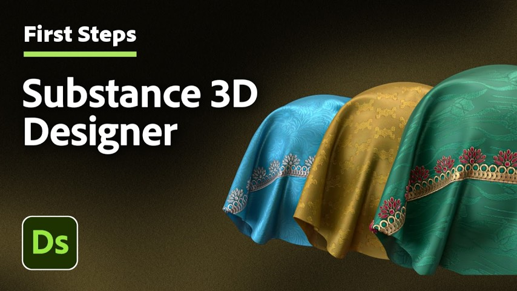

# Getting started

<table style="border: 0">
<tr style="border: 0; vertical-align: top">
<td style="border: 0">

We recommend new users follow our [tutorial series](https://youtube.com/playlist?list=PLB0wXHrWAmCxBw92VSRjqsbqYXgkF8puC&si=88KbfBTpi67mk9CH) for getting started with Substance 3D Designer.

## Course overview

## Project files

<table style="border: 0">
{{sample-ornate-fabric}}
</table>
